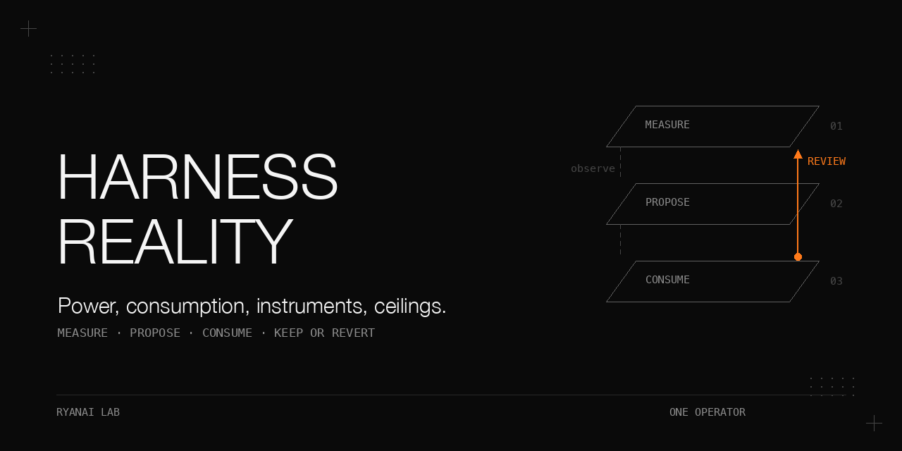

# Self-improving agent harnesses for one person: a reality check

A measure-propose-approve-keep-or-revert loop was built for a single-operator coding-agent setup in July 2026. It never closed end to end. The outcome metric needed about 1,419 labelled tasks per arm to detect a 5-point change from a 37% rework rate, or 26 to 68 weeks at the observed rates. Consumption also stalled: 1 of 78 proposal batches was adopted, 203 of 1,414 calibration rows were labelled, and 0 of 626 promotion candidates were applied. Finally, the instruments themselves were unreliable. This book follows those failures, the narrower mechanisms that survived them, and the limits of the evidence.

The historical results come from a supplied first-hand fact record, including explicitly marked derived calculations. Private ledgers and transcripts are not published. The shipped fixtures are synthetic: they reproduce mechanisms and failure paths, not the historical workload or its rates.

## Why this matters

A healthy producer can feed a dead loop. A passing self-test can protect a measurement layer with almost no data. A compliance score can move because its definition changed. None of those is evidence that a harness improved.

The useful result at this scale was narrower: an append-only evidence ledger, a frozen baseline, an external heartbeat, fault-injection drills, and a hard stop when nobody consumes output. The stop made retirement visible; it did not create a reviewer.

| Question | Evidence | Conclusion supported here |
|---|---|---|
| Can the outcome metric judge a small change? | 1,419 labelled tasks per arm for a 5-point effect at baseline 0.3713 | Too slow for the proposed one-person tuning loop |
| Did proposal production cause adoption? | 1 of 78 batches adopted at the 2026-09-21 audit | Production and consumption need separate evidence |
| Did stopping production restore consumption? | All four lines still paused on 2026-10-03, twelve days after shipment | Visible retirement, with no recorded recovery |
| Did routing adherence improve? | Rules and samples changed; judge errors persisted | No trustworthy improvement curve |

## What is in this book

- [Chapter 1: The loop nobody closed](docs/consumption.md) — audit the consumers, then stop unconsumed production.
- [Chapter 2: Keep-or-revert needs 1,419 labelled tasks per arm](docs/power.md) — calculate power before designing a verdict.
- [Chapter 3: Stage 0](docs/stage-zero.md) — build a read-only measurement chain and prove its alarms.
- [Chapter 4: Measure the opportunity ceiling first](docs/opportunity-ceiling.md) — separate directly identified overhead from a tunable window.
- [Chapter 5: A routing-audit loop, scored honestly](docs/routing-audit.md) — retain the structural detector without inventing a trend result.

[Complete tables](docs/results.md), [expanded pitfalls](docs/pitfalls.md), and [script interfaces](docs/interfaces.md) supply the details.

## The setting

| Item | Historical condition |
|---|---|
| Hardware | One primary Mac, operated by one person; model, processor and memory capacity were not specified |
| OS and scheduling | macOS; launchd user agents; scheduler PATH `/usr/bin:/bin:/usr/sbin:/sbin` |
| Runtime | Python 3.14.6; macOS system bash 3.2.57 |
| Host agent | Command-line coding agent with command hooks, version 2.1.158 |
| Transcripts | JSONL per session, with sub-agent transcripts in a per-session subdirectory |
| Other reviewers | A second-vendor coding agent and a local open-weight reasoning model; hardware for that reviewer was not specified |
| Cheap lane | Pay-per-token router; shell wrappers for fan-out, a verification loop and autonomous work |
| Main lane | Flat-rate subscription with a weekly cap |
| Data at freeze | 178 task rows, 167 labelled, across eight complete calendar weeks at 2026-09-22 |
| Larger snapshots | 370 task rows on 2026-10-03; 145 session logs on 2026-09-27; 187 in the 2026-10-04 re-run |

The offline examples require Python 3.10 or newer and a POSIX shell. The collector uses the standard-library POSIX file lock. No GPU, model server, dependency installation or network is required for the examples. A real routing judge would need a reader-supplied chat-completion adapter; this repository supplies only an offline fixture judge.

The historical private harness and the public [axiom plugin](https://github.com/ryangu00/axiom) share ideas. The measurements here do not describe that plugin.

## Chapter 1: The loop nobody closed

**Problem.** Loops built or rebuilt between 2026-07-03 and 2026-07-07 collected signals, proposed changes and required approval. The 2026-09-21 audit inspected eleven mechanisms after about eleven weeks. Some ran, some stalled silently, and some never landed. No end-to-end improvement cycle was recorded.

**Mechanism.** Register consumption evidence for each producing line: a dated approval marker, the modification time of a review-only watermark, the largest content timestamp in a labels ledger, or an explicit consumption touch file. Use the newest admissible evidence. Pause after 14 days without consumption, or immediately when evidence is absent.

Write one state file atomically with `_ts`, `_threshold_days`, and `{paused, last_consumed, days}` for each line. Every producer calls the same reader. Exit 0 means paused; missing, corrupt, stale, future and unknown-line states fail closed. A reader refuses state older than 3 days because the guard itself may have stopped.

`--consume` records a real review and recomputes state immediately. A session-start status can display paused lines. The guard runs daily. The public config includes marker, mtime and JSONL timestamp examples; timestamps more than five minutes into the future are ignored as consumption evidence.

**Procedure as run.** On 2026-09-21, five read-only reviewers inspected separate questions, and the operator rechecked the headline counts. A four-vote design panel preferred stopping to degrading production by three votes. The guard shipped that night into 2026-09-22 as part of a six-item hardening batch. Reviews returned 14 findings with 12 adopted and 12 findings with 10 adopted.

Conditions: consumption evidence at the 2026-09-21 audit, not a randomized intervention.

| Producing line | Consumed / produced | Rate | Evidence |
|---|---|---|---|
| Routing proposals | 1 of 78 batches | 1.3% | Dated approval marker |
| Calibration labels | 203 of 1,414 rows | 14.4% | Review watermark |
| Promotion candidates | 0 of 626 | 0% | No apply-output file |
| Failure-mining labels | 2 label rows against 72 unclassified items | n/a | Label-file length |

The routing table had six manual edits since creation; only one, on 2026-09-04, came through proposals. No proposal was rejected. The audit interpreted this as absent review, not strict review. Two self-set checkpoints were 45 and 62 days overdue.

Conditions: blind sample from 1,333 proposal-type lines, seed 50; heuristic n=50, hand-read n=12.

| Class | Heuristic count | Hand-read count |
|---|---|---|
| Executable routing-rule proposal | 3 | about 1 (barely) |
| Compliant, nothing to do | 10 | about 5 |
| Existing rule repeated | 7 | about 6 |
| Other observation | 30 | 0 |

Low signal density also mattered. The heuristic's 34% delete rate was a lower bound; the hand-read result was 11 of 12, with that small sample size. A human-budget explanation alone overstates the case.

Conditions: stop-state snapshot on 2026-10-03, twelve days after shipment.

| Line | Last consumed | Days | State |
|---|---|---|---|
| Routing proposals | 2026-09-04 | 29 | paused |
| Calibration review | 2026-07-08 | 87 | paused |
| Failure mining | 2026-07-05 | 89 | paused |
| Promotion candidates | never | n/a | paused |

**What did not work.** Approval requirements had no allocated human time. Review dates became another unattended output. A measurement layer had 54 passing tests and one data row. The planned two-week weekly-review trial had blank decision fields; its 2026-10-05 due date had not arrived at the snapshot.

**Rule.** Every periodic producer needs verifiable consumption evidence and a hard stop when that evidence expires. Expect the stop to retire unused production. The 14-day threshold was a design compromise, not a measured optimum.

The state shape matches the [sibling fail-closed reader](https://github.com/ryangu00/agent-guards-that-fail-silently/blob/main/scripts/is_paused.sh). Deleting state leaves the reader paused; valid fresh state is required to resume.

## Chapter 2: Keep-or-revert needs 1,419 labelled tasks per arm

**Problem.** The proposed verdict was a change in task rework. A task was a closeout row; the orchestrating model supplied the boolean label. Missing labels were unknown, not successful tasks. Independent label validity was never measured.

**Mechanism.** Pool labelled tasks, report a Wilson interval, and use the last complete ISO calendar weeks, including empty weeks. Exclude and count unknown and future timestamps. Keep a weekly-mean bootstrap explicitly separate from a prediction interval.

```text
p1 = pooled baseline; p2 = p1 - effect; pbar = (p1 + p2) / 2
n = (1.96 * sqrt(2 * pbar * (1 - pbar))
     + 0.84 * sqrt(p1 * (1 - p1) + p2 * (1 - p2)))^2 / effect^2
weeks = ceil(n / labelled_tasks_per_week)
```

The constants represent alpha .05 two-sided and power .8, with an independent-task assumption. If the baseline is at or below the effect, or there are no labelled tasks, the result is not estimable. Freeze with exclusive create; an explicit forced replacement retains the old reference.

**Procedure as run.** The first run at 2026-09-22 15:55 estimated about 24 tasks per week, 34% rework and 56 weeks per arm. After independent reviews, the estimator was corrected and frozen at 16:05. The grown ledger and goal-level clustering were examined on 2026-10-03/04 as derived calculations.

Conditions: frozen window 2026-07-27 to 2026-09-21, eight complete calendar weeks.

| Quantity | Value |
|---|---|
| Tasks / labelled / unknown label | 178 / 167 / 11 |
| Rework tasks | 62 |
| Pooled rework | 0.3713; Wilson 95% [0.3016, 0.4467] |
| Excluded unknown / future time | 74 / 1 |
| Labelled tasks per week | 20.9 |
| Effect / required tasks per arm | 0.05 / 1,419 |
| Weeks per arm | 68 |
| Weekly-mean bootstrap | mean 0.3639; 95% interval of the mean [0.2515, 0.4515]; n=5 weeks |

Conditions: derived throughput alternatives for the same fixed requirement of 1,419 tasks.

| Rate basis | Labelled per week | Weeks |
|---|---|---|
| Eight frozen weeks, including 3 empty weeks | 20.9 | 68 |
| Five active weeks at freeze, 167 / 5 | 33.4 | 42.5 |
| Six complete active weeks W34–W39 at 2026-10-03, 325 labelled | 54.2 | 26.2 |
| Busiest week W39, a publishing burst | 158 | 9.0 |

Conditions: derived power table, same formula; grown-ledger row uses 359 labelled tasks at rate 0.376.

| Baseline | 5-point effect | 10-point effect | 15-point effect | 20-point effect |
|---|---|---|---|---|
| Frozen 0.3713 | 1,419 | 341 | 145 | 77 |
| Grown ledger 0.376 | 1,428 | 344 | 146 | 78 |

Goal-file clustering was small: derived ICC 0.002, mean group size 5.52, design effect 1.01, effective n=356 of 359, and adjusted requirement 1,442 versus 1,428. Time dependence and label drift were not tested.

The most frequent proxy did not rescue the design. The outbound-data gate had 209 blocks and 93 overrides in the frozen window: rate 0.3079, Wilson [0.2586, 0.3622]. A 5-point shift needs 1,272 events per arm. At 302 events in 8 weeks, or 37.8 weekly, that is about 34 weeks.

**What did not work.** The first estimator treated unknown labels as successes, skipped empty calendar weeks and misused a weekly-mean interval. The corrected 68-week estimate still depends on the window: the ledger has no timestamped task row before 2026-08-22. The empty weeks do not prove inactivity.

**Rule.** Calculate the sample requirement before building a verdict loop, then divide by observed labelled throughput. Report about 1,420 tasks per arm and a 26-to-68-week range here. Deterministic replay was adopted as a design direction; stage 1 never started, so replay is not a tested improvement result.

## Chapter 3: Stage 0, a read-only loop

**Problem.** With an underpowered verdict and no consumer, the useful remaining work was an honest record, an immutable baseline and observable failure. Stage 0 allowed no knob changes.

**Mechanism.** Normalize configured sources into events with source, kind, denominator, timestamp and content key. The key is source name plus the first 20 SHA-1 hex characters of the raw line. Lock the read-and-append transaction; count identical-line collapse. Mark gate-produced denominators as supporting evidence only.

A missing source or more than 5% malformed lines makes collection degraded: retain the status record, exit 1, and do not refresh the heartbeat. Keep unknown timestamps and flag events more than five minutes in the future. Unknown rework labels stay unknown.

Snapshot effective thresholds by name, including environment overrides, alongside hashes of the classifier, routing rules and registration. Required extraction failure blocks with exit 2. Check before freezing; an existing reference cannot be silently overwritten.

An external watchdog ran every 6 hours. It checked the heartbeat against 168 hours, stop state against 72 hours and baseline against 14 days; missing, unparseable or future state was red. Each run recorded a new run ID and notification return code. The public notifier is configurable and disabled in the offline exercises.

**Procedure as run.** Stage 0 opened at 01:30 and closed at 16:20 on 2026-09-22, about 15 hours. Collection, baseline, diagnosis, watchdog, drills and invariants were followed by independent reviews. The first reviewer returned 10 findings: 4 blockers and 6 major, all adopted; the other review contributed three further adopted items.

Conditions: complete historical drill record on 2026-09-22.

| Time | Scenario | Recorded result | Interpretation |
|---|---|---|---|
| 15:49 | outage, metrics, bad change, concurrent writer | all four recorded as pass | Two were unexecuted placeholders; these passes were invalid |
| 16:00 | outage, metrics | FAIL, FAIL | Red did not return to green; later investigation attributed failures to bash 3.2 empty-array expansion under `set -u` |
| 16:00 | bad change | SKIP | Placeholder |
| 16:01 | outage, metrics | PASS, PASS | Outage notification return code 0 |

The drill back-dates a heartbeat by 8 days or removes a baseline, requires red with the injected reason under a new run ID, restores the input and requires green under another new run ID. Restoration runs on interruption too. Bad-change rollback and concurrent-writer drills remain explicit placeholders.

Conditions: collection snapshot 2026-10-03; historical totals, not fixture output.

| Quantity | Value |
|---|---|
| Events | 1,126 |
| Tasks / outbound blocks / overrides | 370 / 333 / 139 |
| Write-verification fires / second verification fires | 103 / 69 |
| Probes / advisory triggers / snapshots / advisory searches | 86 / 13 / 11 / 2 |
| Source line counts | 370 / 1,838 / 20 / 92 |
| Identical lines collapsed / unknown timestamps | 127 / 74 |

The original diagnostic read only top-level transcripts and reported 0 of 8, but advice was inside sub-agents in 6 cases. Correct attribution gave **1 of 8 within 15 calls**, then **1 of 10** in the 2026-10-03 re-run with 18 triggers. No case establishes that advice changed the next action. See [case 24 of the sibling guards book](https://github.com/ryangu00/agent-guards-that-fail-silently).

**What did not work.** A fresh heartbeat previously concealed missing input. Old watchdog output could pass a crashed drill. The diagnostic's file coverage was unvalidated. Stage-0 closing evidence—769 unique events, four green self-tests, delivered alert and CLEAN invariants—does not establish autonomous improvement.

**Rule.** Validate the measurement chain against readable cases and injected faults. A degraded collector may not announce health. The loop may not modify its own judge, metric, collector or tests; see the evaluation counterpart in [westpoint-agent-eval-rigged-sandbox](https://github.com/ryangu00/westpoint-agent-eval-rigged-sandbox).

Stage 1 and stage 2 were designed but not run. The design included bounded parameter changes, one live experiment, insufficient evidence as undecided, and human approval for routing promotion. Details remain labelled design in [the chapter](docs/stage-zero.md).

## Chapter 4: Measure the opportunity ceiling first

**Problem.** Before building a fast lane for routine orchestration, measure how much work it could possibly take. A ceiling is not a measured saving.

**Mechanism.** Classify assistant turns by first match: plan-writing, routing, review, question, closeout, text-only, work. The first five are direct overhead. Add only text-only/work turns within a configurable preceding window of plan-writing, routing, review or closeout. A question does not anchor the window.

The public oracle takes tool names and path patterns from JSON configuration and emits aggregates only. The companion inventory accepts bold table labels followed by a parenthesized criterion. Route comparisons normalize enums and report unknowns separately.

**Procedure as run.** A synthetic-only implementation was run locally on 2026-09-27 over 145 sessions with 0 skipped lines. Three unit tests used 14 synthetic turns. The sensitivity re-run on 2026-10-04 scanned 187 live sessions at windows 0, 2, 6 and 12.

Conditions: 2026-09-27, 76,976 assistant turns, 101.9 million output tokens, window=6.

| Component | Turns | Turn share | Output tokens | Output share |
|---|---|---|---|---|
| Direct overhead | 3,911 | 5.08% | 6,983,716 | 6.85% |
| Preceding window | 13,084 | 17.00% | 22,289,614 | 21.88% |
| Total overhead | 16,995 | 22.08% | 29,273,330 | 28.73% |

Conditions: derived 2026-10-04 sensitivity, 187 sessions and about 82.8 thousand turns; live writes caused small count differences.

| Window | Overhead turn share | Output-token share |
|---|---|---|
| 0 | 4.82% | 6.84% |
| 2 | 11.86% | 17.53% |
| 6 | 20.99% | 28.48% |
| 12 | 30.65% | 38.61% |

The window contributed 77% of the original overhead turns. Directly identified overhead was about 5.1%; the headline 22.1% depended mostly on a guessed window.

For 101 outcome rows since the 2026-09-21 enum rule, 82 matched and 19 differed. Of the 19, 14 were a split spelling of the main-model route. Matching rows had 27 of 82 rework (32.9%); differing rows had 10 of 19 (52.6%). The intervals overlap and n is small.

**What did not work.** The first parser recognized 2 of 23 bold row names despite green tests because the synthetic table omitted the parenthesized criterion. Free text previously made 90 of 216 rows (42%) look like deviations. The 25% go bar was not decisively cleared: 22.1% of turns was below it, while 28.7% of output tokens was above it.

**Rule.** Measure the ceiling before building, separate direct classification from window attribution, and show sensitivity. The share of routine judgement that another mechanism could actually take over was never measured.

## Chapter 5: A routing-audit loop, scored honestly

**Problem.** A subscription cap motivated routing routine independent work to another lane. Moving work between model tiers on the same subscription did not protect that cap.

**Mechanism.** A shape-to-route table records route, quality gate and basis. A closeout ledger records declared route, actual route, result and tri-state rework. The public [table template](https://github.com/ryangu00/axiom/blob/main/templates/ROUTING.template.md) illustrates the format; the private table is not included.

The daily audit at 08:45 first made a real liveness call with a 60-second deadline, then inspected up to the 6 largest top-level sessions modified in the last 24 hours and larger than 100 KB, using the last 60 actions. Collection and the consumption guard preceded proposal production. An atomic directory lock had a 2-hour stale timeout; logs rotated above 5 MB.

Classify handlers separately from verdicts. Subscription sub-agents never count as offloading. The first pendulum rule is `adherence >= 80 and cheap_dispatch == 0 and WASTE > 0`; the second is `inline_workflow_agents >= 2` with no cheap dispatch in the window. Three consecutive audits below 60% produce a structural warning. The public audit takes an injected judge function and stores a rule hash.

**Procedure as run.** The first audit on 2026-06-25 reported 13% adherence and 48 of 55 actions WASTE. Trend recording and the first pendulum detector followed on 2026-06-26; workflow inspection followed on 2026-06-29. The routing table and outcome loop were built on 2026-07-07. A liveness probe was added on 2026-09-14 and hardened for the scheduler on 2026-09-21.

Conditions: 387 trend rows from 2026-06-26 to 2026-10-02; 93 daily runs since 2026-07-07. Rules and sampling changed.

| Month | Audits | Adherence quartiles 25 / 50 / 75 | Mean | Any offload | Offloaded / audited actions |
|---|---|---|---|---|---|
| 2026-06 | 13 | 15.0 / 91.7 / 95.5 | 64.7 | 5 | 32 / 654 (4.9%) |
| 2026-07 | 101 | 50.0 / 81.7 / 96.0 | 69.6 | 9 | 26 / 5,272 (0.5%) |
| 2026-08 | 133 | 45.0 / 75.0 / 91.7 | 66.1 | 21 | 109 / 7,861 (1.4%) |
| 2026-09 | 134 | 45.0 / 70.0 / 90.0 | 64.5 | 15 | 44 / 7,946 (0.6%) |
| 2026-10 to 10-02 | 6 | 0.0 / 55.9 / 77.1 | 46.7 | 0 | 0 / 360 |

July–September offloading was 179 of 21,079 audited actions (0.8%). The falling median and roughly flat mean cannot establish improvement or decline because the instrument changed.

Conditions: outcome ledger at 2026-10-04, 400 rows, 389 labelled; seed aggregate is from the frozen 2026-07-07 document.

| Period | Labelled | Rework | Rate | Wilson 95% |
|---|---|---|---|---|
| 2026-08 from 08-23 | 30 | 9 | 30.0% | 16.7 to 47.9 |
| 2026-09 | 312 | 121 | 38.8% | 33.5 to 44.3 |
| 2026-10 to 10-03 | 47 | 18 | 38.3% | 25.8 to 52.6 |
| Seed aggregate | 19 | 4 | 21.1% | 8.5 to 43.3 |

The earliest baseline rows are **no longer present; the reason was not established**. The one-month acceptance criterion has no conclusion file. The seed and later rates are statistically indistinguishable in this record.

**What did not work.** The judge repeated the same wrong call 18 times; on 2026-09-20 that error alone produced 12 WASTE rows and 14.3% adherence. A local-only rule was added on 2026-09-21. Six consecutive probe failures with exit 127 came from a missing `timeout` under the scheduler PATH, while the lane worked interactively.

The dispatch ledger had 5,538 lines on the derived 2026-10-04 inspection: 4,080 were single-character `0` lines in five runs (74%). Their cause was not established. Counting all lines as delegation evidence was invalid. Among 765 status-bearing rows, 79 failures meant 10.3%; this is a different denominator from the old baseline.

The frozen 2026-07-07 comparison estimated main-model cost at 8.3 times cheap-lane spend over 1,045 dispatches, using list prices. Usage was not returned. One short-task demo incurred 386K tokens of orchestration overhead; its estimated overhead cost was about 1.03 times the saving before overhead, yielding a net loss. That ratio is derived from rounded estimates for one demo, not a series.

**Rule.** Version the instrument, hand-check judge verdicts, and judge outcomes independently. The loop produced a routing table and a useful pendulum detector. The central hypothesis that measurement would improve routing remains unsupported. [ryanai-evalbank](https://github.com/ryangu00/ryanai-evalbank) shares the measurement-chain discipline.

## Pitfalls

| Symptom | Root cause | Fix |
|---|---|---|
| Daily success, no useful production | Refusal mapped to exit 0 | Report refusal; require consumption evidence |
| Backup makes review look recent | Using mtime instead of content time | Read content timestamps where available |
| Better-looking rework | Unknown labels counted as success | Preserve unknown and its denominator |
| Healthy collector with no sources | Unconditional heartbeat refresh | Degraded input must not refresh health |
| A drill passes after a crash | Old state accepted as new evidence | Require a new run ID and the injected reason |
| Large opportunity estimate | Guessed preceding window dominates | Publish direct share and sensitivity |
| High adherence, no offload | Same subscription pays both tiers | Count actual lane dispatches |
| A trend moves between months | Rules, sample and judge changed | Store rule versions and validate verdicts |

The [expanded pitfalls](docs/pitfalls.md) retain every source failure table and explain the public contract checks.

## Reproduce it without our infrastructure

These commands run only synthetic examples from the repository root. Keep scratch files local. They neither install scheduled jobs nor invoke a model.

1. Prepare local scratch space and run the complete offline tests.

```bash
mkdir -p .work/tmp
export TMPDIR="$PWD/.work/tmp"
export PYTHONDONTWRITEBYTECODE=1
python3 -m unittest discover -s tests -v
(cd scripts/overhead_oracle && python3 -m unittest test_p0.py -v)
```

2. Collect synthetic sources with a fixed observation time, then freeze their baseline. This illustrative dataset does not have the historical rate.

```bash
python3 scripts/ledger_collect.py --config configs/sources.json --source-root fixtures --state-dir .work/demo --now 2026-09-22T12:00:00Z
python3 scripts/power_baseline.py --events .work/demo/events.jsonl --state-dir .work/demo --now 2026-09-22T12:00:00Z --table --freeze
python3 scripts/power_table_and_icc.py fixtures/tasks.jsonl
```

3. Evaluate consumption, observe the pause, simulate a review, and read the state again. The reader returns 1 for active, so that exit is expected.

```bash
python3 scripts/consumption_guard.py --config configs/consumption.json --state-dir .work/demo
bash scripts/is_paused.sh proposals .work/demo/paused.json
python3 scripts/consumption_guard.py --config configs/consumption.json --state-dir .work/demo --consume proposals
bash scripts/is_paused.sh proposals .work/demo/paused.json
bash scripts/proposals_producer.sh --state-dir .work/demo fixtures/lessons.txt fixtures/tasks.jsonl
```

4. Diagnose nested advice and freeze/check named invariants.

```bash
python3 scripts/advisory_diagnosis.py --triggers fixtures/triggers.jsonl --sessions fixtures/advisory --marker ADVICE --search-tool search --state-dir .work/demo
python3 scripts/knob_invariants.py --config configs/invariants.json --root fixtures --state-dir .work/demo --freeze
python3 scripts/knob_invariants.py --config configs/invariants.json --root fixtures --state-dir .work/demo --check
```

5. Refresh the synthetic baseline timestamp for watchdog liveness, then inject faults without notifications. The fixed-time baseline above is for statistics, not current liveness.

```bash
python3 scripts/power_baseline.py --events .work/demo/events.jsonl --state-dir .work/demo
bash scripts/watchdog.sh --state-dir .work/demo --dry-run
bash scripts/drill.sh all --state-dir .work/demo --no-discord
```

6. Compare oracle windows, inventory the synthetic plans, normalize routes, and exercise the fixture judge.

```bash
python3 scripts/overhead_oracle/oracle.py --sessions fixtures/sessions --config configs/oracle.json --window 6 --out .work/oracle.json
python3 scripts/overhead_oracle/window_sensitivity.py fixtures/sessions configs/oracle.json
python3 scripts/overhead_oracle/shapes.py --goals fixtures/goals --routing fixtures/routing.md --out .work/shapes.json
python3 scripts/overhead_oracle/declared_actual.py --ledger fixtures/tasks.jsonl --out .work/routes.json
python3 scripts/routing_audit.py --transcript fixtures/audit.jsonl --config configs/audit.json --judge-fixture fixtures/judge.json --state-dir .work/demo
```

A second freeze deliberately refuses an existing reference. Use a fresh state directory when repeating the exercise, or explicitly preserve-and-replace with `--force`. [Interfaces and adaptation notes](docs/interfaces.md) define the schemas, exit codes and reader-owned integration prerequisites.

## Limits and open questions

- One operator, one workload and one agent lineage; loops were built in July and inspected through October 2026. Routing-audit records also include June. These are not general rates.
- Rework labels were self-reported. Goal-level ICC was small, but independent label validity, time dependence and label drift were not tested.
- The stop threshold and hard-stop choice were panel decisions. Twelve days of visible retirement do not establish improved consumption.
- Stage 1 and stage 2 did not run. Deterministic replay, bounded autonomous changes and promotion policy remain design.
- The proposal heuristic was crude, the hand-read sample had n=12, and the oracle window was unvalidated.
- Routing rules, sampled sessions and judge behavior changed. There was no controlled human-labelled evaluation of the judge.
- Cost comparisons were list-price estimates. Causes of the junk lines and missing seed rows were not established.
- Private source rows, scheduler integration, production notification delivery and a real judge adapter cannot be reconstructed from the public fixtures.

## Files

- `scripts/` — baseline/power, collection, consumption, diagnosis, invariants, watchdog, drills, producer skeleton and reduced routing audit.
- `scripts/overhead_oracle/` — configurable turn classifier, window sensitivity, aggregate plan inventory, route comparison and the synthetic test suite.
- `configs/` — public example source mappings, evidence registration, invariant extraction, oracle patterns and audit handler names.
- `fixtures/` — artificial task rows, transcripts, plans, rules and fixed judge answers; regenerate with `scripts/make_fixtures.py` into a separate directory.
- `tests/` — offline contract and failure-path tests; no private data required.
- `docs/` — full chapter depth, all source tables, pitfalls, interfaces and the unchanged banner drawing template with book-specific text labels.
- `LICENSE`, `.gitignore` — supplied templates copied as-is.

## Related cookbooks

- [agent-guards-that-fail-silently](https://github.com/ryangu00/agent-guards-that-fail-silently) — guard liveness, negative probes, the state reader and case 24's diagnostic correction.
- [axiom](https://github.com/ryangu00/axiom) — public routing-table format and human approval stance; a separate system from the measured harness.
- [two-coding-agents-side-by-side](https://github.com/ryangu00/two-coding-agents-side-by-side) — cross-vendor review context.
- [sandboxed-coding-agent-workers](https://github.com/ryangu00/sandboxed-coding-agent-workers) — isolated worker context.
- [ryanai-evalbank](https://github.com/ryangu00/ryanai-evalbank) — measurement discipline.

The evaluation sandbox counterpart is linked in Chapter 3.

## License

Apache-2.0. See [LICENSE](LICENSE).
